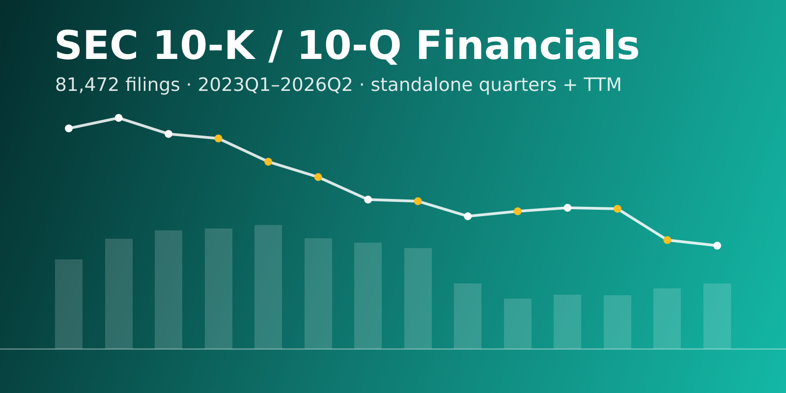
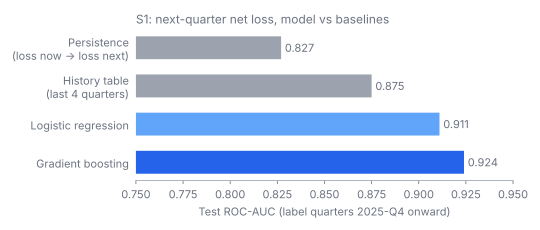

# Next-Quarter Loss Forecast from SEC Filings



**Will a U.S. public company report a net loss next quarter?** This project builds a leakage-safe forecast from the financial statements companies file with the SEC (Forms 10-K and 10-Q). It then checks the forecast against the simplest rule that could replace it, which is "a company losing money now will lose money next quarter".

[](https://www.kaggle.com/code/siemmebrahtu/next-quarter-loss-forecast-from-sec-filings)
[](https://www.kaggle.com/datasets/siemmebrahtu/sec-10k-10q-wide-v3)


[](LICENSE)


---

## Results at a glance



| Measure (test period, label quarters 2025-Q4 onward) | Result |
|---|---|
| Gradient boosting ROC-AUC | **0.924** (95% CI 0.918 to 0.929, company-clustered bootstrap) |
| Gradient boosting PR-AUC | **0.911**, compared with 0.755 for persistence |
| Lift over persistence, filing-date protocol | **+0.099** ROC-AUC (CI +0.094 to +0.106) |
| Rolling-origin evaluation | beats persistence in **7 of 7** origins (mean lift +0.102) |
| Walk-forward, filing-date protocol | beats persistence in **8 of 8** origins (mean lift +0.107) |
| Transitions only (rows where the sign of profit changes) | ROC-AUC 0.847 |
| Companies never seen in training | ROC-AUC 0.890 |
| Threshold chosen on validation (0.424) | test precision 0.823, recall 0.872 |
| Out-of-time cross-check (GroupKFold by company, clipping fitted inside each fold) | boosting 0.933 ± 0.003, logistic 0.915 ± 0.004 |

The model has **not been tuned**. All settings were fixed in advance, and every choice (feature set, cheaper model, thresholds) was made on the validation period.

## The question

| Target | Definition | Status |
|---|---|---|
| **S1** (main) | Next quarter's standalone net income is below zero | Main result |
| **S2** (exploratory) | Total equity turns negative next quarter | Promising screen, not established (see below) |
| **U1** | k-means "financial archetypes" (k = 7) used as an extra feature | Adds nothing on validation (−0.0003 ROC-AUC), reported as a negative result |

## Why the evaluation can be trusted

Most of the work goes into ruling out the usual ways a financial forecast leaks the future.

- **Time split by label quarter.** The model trains on labels up to 2024-12-31, is validated up to 2025-09-30 and is tested after that. No company-quarter appears on both sides of a split.
- **Filing-date protocol.** A label only counts as known once the next filing was actually submitted (`label_known_date`). Under the plain label-quarter split, 17% of the training labels were not yet public. The filing-date version gives the same answer (test 0.925, validation 0.933).
- **Leakage-prone fields removed.** For example, the amendment flag is excluded because whether a filing gets amended is only known afterwards.
- **Clip limits fitted on training rows only**, including inside every cross-validation fold.
- **Strong baselines.** Persistence and a four-quarter history table are what the model has to beat, not a coin flip.
- **Honest use of the test period.** The test period was looked at in earlier versions of the notebook, so it is not a fully untouched hold-out. The notebook says so plainly. Every decision is now made on validation, and a single-use final test on filings published after this release is described as the next step. No external validation result is claimed.

## S2: an exploratory negative-equity screen

S2 ranks companies well (ROC-AUC 0.959, and its lift over the burn-rate rule is +0.121 [+0.082, +0.164]), and the top 10% of scores capture 88.7% of events. However, there are only 141 test events. The PR-AUC lift over the best rule is +0.060 with a confidence interval of [−0.011, +0.131], which **crosses zero**. S2 is therefore reported as a promising exploratory screen, not a proven improvement.

## Where it works less well

- **Fund-like filers** (BDCs, credit and income funds): ROC-AUC 0.613, compared with 0.927 for everyone else. Their "losses" are mostly unrealised marks rather than operating results.
- **Turning points** are harder than steady states (0.847 on transitions).
- A cheaper **top-8-feature boosting model** keeps 96% of the lift on validation (95% on test). A top-8 logistic regression keeps only 46%.

## Repository layout

```
.
├── notebooks/
│   └── next-quarter-loss-forecast.ipynb   # the full analysis (Parts 1 to 3, model card)
├── docs/
│   ├── DATA_CARD.md                       # what every column means and how the data was built
│   └── reports/
│       ├── complete-guide.pdf             # cell-by-cell walkthrough of the method
│       ├── audit-report.pdf               # leakage and correctness audit
│       └── change-report.pdf              # what changed between versions and why
├── tests/
│   └── smoke_test.py                      # runs every code cell on a synthetic panel
├── assets/                                # cover image and README chart
├── requirements.txt
└── LICENSE
```

## Notebook structure

| Part | Cells | Content |
|---|---|---|
| **1. S1 core** | 1 to 13 | Load, standalone quarterly profit, label and lags, time split, baselines, models, lift and calibration, slices, permutation importance, biggest mistakes by name, rolling origin, ablation, fund-like filers |
| **2. Extensions** | 14 to 17 | U1 archetypes, cheaper model, S2 negative-equity target, headline table |
| **3. Reliability** | 19 to 22 | Bootstrap confidence intervals, thresholds chosen on validation, later-period, unseen-company and external hooks, auto-generated model card |

## How to run

**On Kaggle (easiest).** Open the [notebook](https://www.kaggle.com/code/siemmebrahtu/next-quarter-loss-forecast-from-sec-filings) and click *Copy & Edit*. The dataset is already attached.

**Locally.**

```bash
git clone https://github.com/<SiemMeb>/sec-next-quarter-loss-forecast.git
cd sec-next-quarter-loss-forecast
pip install -r requirements.txt
kaggle datasets download -d siemmebrahtu/sec-10k-10q-wide-v3 -p data --unzip
jupyter lab notebooks/next-quarter-loss-forecast.ipynb
```

Set `DATA_DIR` in Cell 1 to `"data"` when running locally. Cell 2 reads only the columns S1 needs, so memory use stays modest even though the panel has 1,730 columns.

**Smoke test (no download needed).** This runs every code cell on a synthetic panel with the same schema:

```bash
python tests/smoke_test.py
```

## Data

The data comes from the **SEC Financial Statement Data Sets** (Division of Economic and Risk Analysis), reshaped into one row per canonical filing:

- 81,472 filings from more than 6,000 companies
- 14 quarterly releases, 2023-Q1 to 2026-Q2
- 1,730 columns, including standalone-quarter (`_qtr`) and trailing-twelve-month (`_ttm`) measures

Earlier versions of amended filings (1,662 rows) are kept in a separate file. See [docs/DATA_CARD.md](docs/DATA_CARD.md) for the full data card and the [Kaggle dataset](https://www.kaggle.com/datasets/siemmebrahtu/sec-10k-10q-wide-v3) for the files.

## Limitations

- The history is short: about two years of training labels, so seasonality is learned from at most two cycles.
- Values are as filed. Scale errors in some tags are handled with ratios and clipping, not corrected.
- The test period is not a completely untouched hold-out (see above).
- S2 is exploratory.
- The model card in Cell 22 lists the intended use and the uses it is not meant for.

## For forks and extensions

- Run a **single-use final test** on filings released after 2026-Q2, with the model frozen as it is.
- Use separate models or targets for **fund-like filers**, whose losses mean something different.
- Collect more S2 events (a longer history) before drawing conclusions about negative equity.
- Add **text features** from MD&A or going-concern language.

## License

The code is under the [MIT License](LICENSE). The data is U.S. government data in the public domain, and the derived dataset is released under CC0.

*This project is for research and education only. It is not investment advice.*
